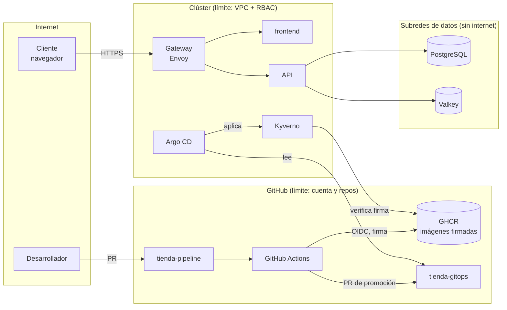

# Modelo de amenazas de la tienda

Revisado: 2026-10. Revísalo cuando cambie la arquitectura (nuevo servicio, nueva integración,
nuevo dato sensible).

## Qué estamos construyendo

Los flujos que cruzan un límite (flechas entre cajas) son donde se concentran las amenazas.

## Qué puede salir mal (STRIDE) y qué hacemos

| Flujo | Amenaza | STRIDE | Mitigación | Estado |
|---|---|---|---|---|
| Cliente → Gateway | Inundar `/api/productos` | D | Rate limiting en el Gateway, autoescalado (HPA) | Pendiente: rate limiting |
| Cliente → API | Pedir con `cantidad` negativa o enorme | T | Validación en servidor (Pydantic `gt=0, le=100`) | ✔ |
| Cliente → API | Inyección SQL en los parámetros | T, I | Consultas parametrizadas; regla de Semgrep `sql-construido-con-texto` | ✔ |
| API → PostgreSQL | Robo de la contraseña de la base | I | Secreto en Secrets Manager con rotación, inyectado por ECS/ESO; nunca en Git | ✔ |
| API → Valkey | Caché caída sin que nadie lo sepa | D | Degradación registrada en logs (`Caché no disponible`) | ✔ |
| Desarrollador → repo | Secreto subido por error | I | gitleaks en pre-commit y CI, push protection | ✔ |
| CI → GHCR | Imagen alterada con la misma etiqueta | T | Firma keyless por digest; Kyverno solo admite lo firmado por `image.yml` en `main` | ✔ |
| CI → GHCR | Dependencia o imagen base con CVE crítica | T, E | Trivy bloqueante, Dependabot, base mínima | ✔ |
| CI (acciones de terceros) | Acción comprometida | T | Acciones fijadas por SHA, zizmor, permisos mínimos por job | ✔ |
| Argo CD → clúster | Alguien cambia producción a mano | R, T | selfHeal, RBAC de solo lectura para personas, audit logs | ✔ |
| Pod de la API | Escape del contenedor al nodo | E | No root, sin capabilities, seccomp, Pod Security `restricted` | ✔ |
| Pod de la API | Shell o conexión saliente inesperada | E, I | Falco (`reglas-tienda.yaml`), NetworkPolicy de salida | ✔ |
| Personas → AWS | Credenciales de larga duración filtradas | S | Solo SSO y OIDC, sin claves de acceso | ✔ |

## Riesgos aceptados

- Sin autenticación de clientes: la tienda de ejemplo no tiene cuentas de usuario. Cuando las
  tenga, añade BOLA (un cliente ve pedidos de otro) y fuerza bruta en el login a este modelo.
